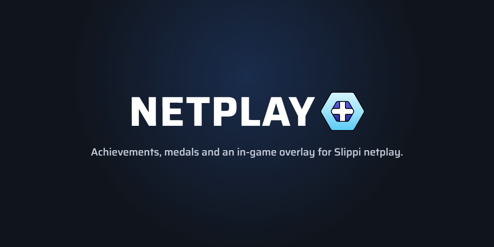

  

Official release builds for **Netplay+** — achievements, medals and an in-game
overlay for Slippi netplay.

### 🚀 Download

**[Get the latest version](https://eggs-ssbm.github.io/npp-releases/)**

Or take the Windows installer straight from the
[latest release](https://github.com/eggs-ssbm/npp-releases/releases/latest),
or the Linux AppImage from
[this link](https://github.com/eggs-ssbm/npp-releases/releases/latest/download/netplay-plus-x86_64.AppImage),
which always serves the newest version.

### 🔄 Updates

Netplay+ updates itself on Windows and Linux. It checks on launch and installs
new versions in the background, so you only need to download manually once.
(Linux copies update themselves from v0.9.123 on.)

Do **not** delete your existing installation before updating — the updater
replaces it for you, and removing the folder by hand loses your local settings.

### 💻 Requirements

- Windows 10 or later, or 64-bit Linux (AppImage; on Ubuntu 22.04 and newer,
  install `libfuse2` — `libfuse2t64` on 24.04 — and allow the file to run as a
  program)
- [Slippi Dolphin](https://slippi.gg/)
- A Slippi connect code

### 📦 Contents

Each release includes:

| File | What it is |
| --- | --- |
| `netplay-plus-Setup-{version}.exe` | the Windows installer — this is the one you want on Windows |
| `netplay-plus-x86_64.AppImage` | the Linux app — this is the one you want on Linux |
| `netplay-plus-{version}-full.nupkg` | Windows update package, used by the auto-updater |
| `RELEASES` | Windows update manifest, used by the auto-updater |
| `latest-linux.yml` | Linux update manifest, used by the auto-updater |

### 🔒 Access

This repository only hosts builds. Only official builds are uploaded by the
developer.

---

Not affiliated with Nintendo or Project Slippi.
